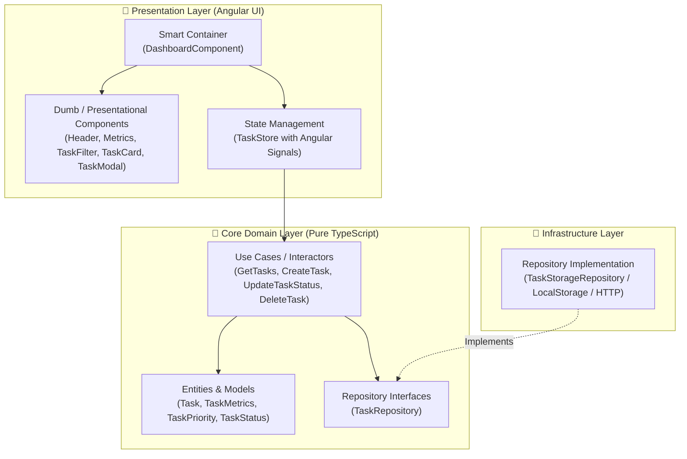

# TaskFlow Dashboard · Angular 18 Clean Architecture Showcase

[](https://angular.dev)
[](https://www.typescriptlang.org/)
[](https://angular.dev/guide/signals)
[](https://blog.cleancoder.com/uncle-bob/2012/08/13/the-clean-architecture.html)
[](https://angular.dev/guide/components)

A modern, responsive web dashboard built with **Angular 18**, demonstrating **Clean Architecture**, **Angular Signals (`signal`, `computed`)**, **Standalone Components**, and the **Smart & Dumb Component Pattern** with zero external UI library bloat.

---

## 🏛️ Architecture Overview

The frontend is strictly architected following the **Dependency Inversion Principle**: the Domain Layer remains independent of Angular framework details and external storage implementations.



### Key Architectural Patterns

1. **Angular Signals for State**:
   - `signal()` manages reactive state slices (`tasks`, `filter`, `searchQuery`, `loading`).
   - `computed()` automatically derives real-time metrics (`total`, `pending`, `inProgress`, `completed`, `completionRate`) without unnecessary re-renders.
2. **Smart & Dumb Component Architecture**:
   - `DashboardComponent` acts as the single Smart Container coordinating use cases and state.
   - Child components (`MetricsComponent`, `TaskCardComponent`, `TaskFilterComponent`) are pure Presentational components relying on `@Input()` and `@Output()`.
3. **Dependency Inversion**:
   - `TaskRepository` is an abstract class token. `TaskStorageRepository` provides the implementation via Angular's `providers: [{ provide: TaskRepository, useClass: TaskStorageRepository }]`.

---

## 📁 Project Structure

```
src/app/
├── app.config.ts                      # App bootstrap & Dependency Injection providers
├── app.routes.ts                      # Standalone routing configuration
├── app.component.ts                   # Root shell component
├── core/
│   ├── domain/
│   │   ├── entities/                  # Task, TaskPriority, TaskStatus, TaskMetrics
│   │   ├── repositories/              # TaskRepository (abstract contract)
│   │   └── usecases/                  # GetTasks, CreateTask, UpdateTaskStatus, DeleteTask
│   └── infrastructure/
│       └── repositories/              # TaskStorageRepository (LocalStorage / Mock)
└── presentation/
    ├── state/
    │   └── task.store.ts              # Signal-based store & computed selectors
    └── components/
        ├── header/                    # Navbar with search input & modal trigger
        ├── metrics/                   # KPI metric cards with progress bar
        ├── task-filter/               # Status tab filters
        ├── task-card/                 # Task item card with priority & status selector
        ├── task-modal/                # Reactive form modal for creating tasks
        └── dashboard/                 # Smart container page
```

---

## ✨ Features

- **100% Standalone Components**: Built without legacy `NgModules`.
- **Reactive State with Signals**: Fine-grained reactivity powered by Angular 18 Signals.
- **Computed Metrics**: Live calculations of total count, progress, and completion percentages.
- **Search & Filtering**: Search across titles, categories, and descriptions combined with status filters.
- **Form Validation**: Reactive forms with error messaging for task creation.
- **Self-Contained Persistence**: Works immediately out of the box with browser storage and seed tasks.

---

## 🚀 Getting Started

### Prerequisites
- [Node.js](https://nodejs.org/) v18.19.0 or higher
- npm 9.0 or higher

### Installation & Run

```bash
# 1. Clone the repository
git clone https://github.com/v1dalhernan/angular-clean-architecture-dashboard.git
cd angular-clean-architecture-dashboard

# 2. Install dependencies
npm install

# 3. Start development server
npm start
```

Navigate to `http://localhost:4200/` in your browser.

### Build for Production

```bash
npm run build
```

---

## 👤 Author

**Jhonathan Vidal**
- GitHub: [@v1dalhernan](https://github.com/v1dalhernan)
- LinkedIn: [Jhonathan Vidal](https://www.linkedin.com/in/jhonathan-vidal/)
